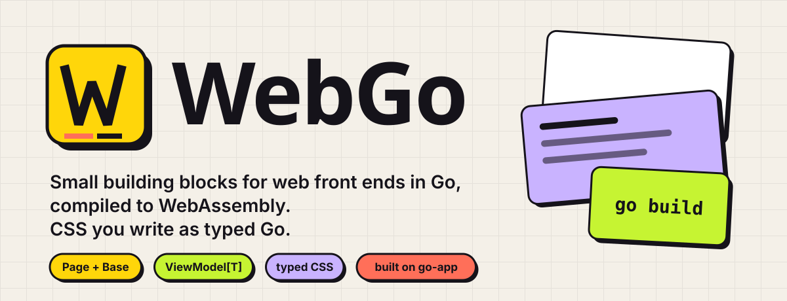
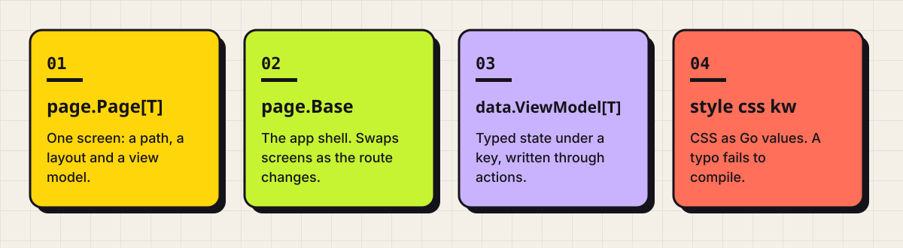
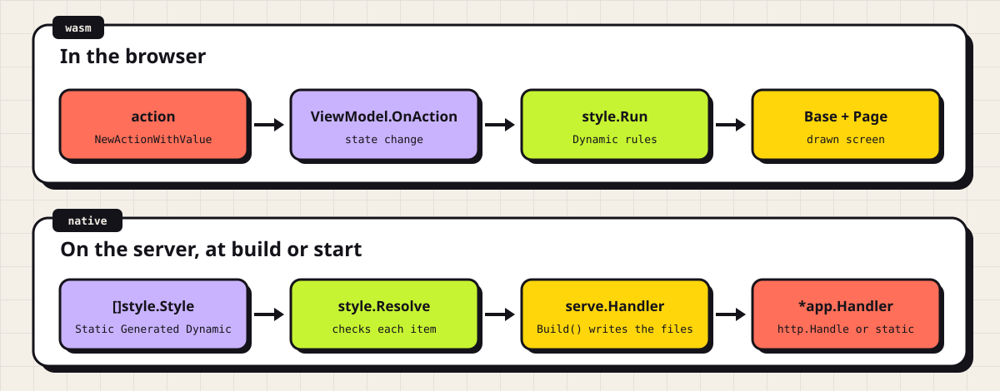
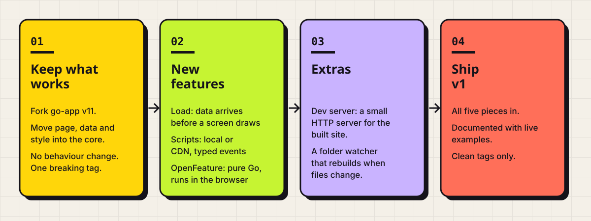

<p align="center">
<picture>
  <source media="(prefers-color-scheme: dark)" srcset=".github/readme/hero-dark.svg">
  
</picture>
</p>

<p align="center">
  <a href="https://toms223.github.io/WebGo/">
    <picture>
      <source media="(prefers-color-scheme: dark)" srcset=".github/readme/docs-dark.svg">
      
    </picture>
  </a>
</p>

WebGo sits on top of [go-app](https://github.com/maxence-charriere/go-app) and adds four things: a `Page` that pairs a layout with a view model, a `Base` that swaps pages by route, a `ViewModel` that holds the state a page reads and writes, and typed styling, which writes CSS as Go values that the compiler checks. A markdown renderer is included for pages whose content is written as text.

<p align="center">
<picture>
  <source media="(prefers-color-scheme: dark)" srcset=".github/readme/features-dark.svg">
  
</picture>
</p>

**Documentation: https://toms223.github.io/WebGo/**

The docs site is itself a WebGo app — it is built with the packages it documents, and its markdown is rendered by `RenderMarkdown`. The source is in [`docs/`](docs/).

## Install

```sh
go get github.com/Toms223/WebGo@v0.0.5
```

`v0.0.5` is the current release. `v0.0.3` added `ViewModel.State()`; `v0.0.4` made `Base` work when the app is mounted under a subpath rather than at the domain root; `v0.0.5` renamed the `model` package to `data`. `v0.0.1` and `v0.0.2` do not work and should not be used.

You will import `github.com/maxence-charriere/go-app/v11/pkg/app` directly too, so run `go mod tidy` afterwards to record it as a direct dependency.

## Quick start

A WebGo app is one Go program that runs in two places: compiled to WebAssembly in the browser, and natively on your machine to serve or generate the site.

```go
package main

import (
	"net/http"

	"github.com/maxence-charriere/go-app/v11/pkg/app"
)

type hello struct {
	app.Compo
}

func (h *hello) Render() app.UI {
	return app.Text("Hello, WebGo")
}

func main() {
	app.Route("/", func() app.Composer { return &hello{} })
	app.RunWhenOnBrowser()

	http.Handle("/", &app.Handler{Name: "Hello"})
	http.ListenAndServe(":8080", nil)
}
```

`app.RunWhenOnBrowser` takes over when the binary is running as WebAssembly and does nothing otherwise, so execution falls through to the server code on your machine. Register every route before calling it, and return a fresh component instance from each factory.

Build the browser binary, then run the server:

```sh
GOARCH=wasm GOOS=js go build -o web/app.wasm .
go run .
```

## The parts

| Type | What it does |
| --- | --- |
| `page.Page[T]` | One screen: a path, a `Layout[T]`, and a `ViewModel[T]` |
| `page.Base[U]` | The app shell: holds the screens and switches between them on navigation |
| `data.ViewModel[T]` | Typed state under a key, readable from a layout and writable through an action |
| `page.Layout[T]` | Interface you implement: loading, error and drawn states |
| `page.Screen` | Interface a screen satisfies; `*Page[T]` already does |
| `style.Rule` | One CSS rule as a Go value: a selector, its properties, its pseudo-class, `@media`, `@container` and `@supports` blocks, and nested rules |
| `style.Item` | Anything a stylesheet holds: a `Rule`, `KeyframesRule`, `FontFaceRule`, `PropertyRule`, `ImportRule`, `LayerRule` or `LayerOrderRule` |
| `style.KeyframesRule` and friends | `@keyframes`, `@font-face`, `@property`, `@import` and `@layer` as Go values, made by `Keyframes`, `FontFace`, `Property`, `Import`, `Layer` and `LayerOrder` |
| `style.Binding` | A typed link from an action to a rule: `When` decides presence, `Compute` and `ComputeFrames` decide the properties or frames |
| `style.Style` | How items reach the browser: a `Static` file, a `Generated` file, or `Dynamic` items switched by actions |
| `serve.Handler` | go-app's `app.Handler` with `Styles []style.Style`; `Build()` checks them, writes the generated files and returns the `*app.Handler` |
| `css` | Typed values (`Px`, `Hex`, `Var`, `Calc`, `Raw`), one function per CSS property, and `Important()` on every property |
| `css.Descriptor` | One declaration inside `@font-face` or `@property`, such as `css.Src` or `css.Syntax` |
| `kw` | One typed constant per CSS keyword and named color, such as `kw.Underline` |
| `media` | Media queries (`Screen`, `Print`, `Not`, and `And` and `Or` on a query) and the functions for each media feature |
| `container.Query` | Container queries (`Named`, `Not`, `And`, `Or`) and the functions for each container feature |
| `supports.Query` | `@supports` conditions: `Property`, `Selector`, `FontFormat`, `FontTech`, `Not`, `And`, `Or` |
| `markdown` | Renders a markdown string into `[]app.UI` |

### Building a page

`Page` is built by chaining. The first error is latched, so later calls become no-ops and `Err()` reports what went wrong.

```go
state := &AppState{}
vm, err := data.NewViewModel("app", state)
if err != nil {
	log.Fatal(err)
}

p := page.NewPage[AppState]("/settings").
	WithLayout(&settingsLayout{}).
	WithModel(vm)

if err := p.Err(); err != nil {
	log.Fatal(err)
}
```

`NewPage("")` serves `/` — `Route()` always returns a leading slash.

### Implementing a layout

```go
type Layout[T any] interface {
	Loading() app.UI
	Error(error) app.UI
	Draw(m *data.ViewModel[T]) app.HTMLDiv
	Body(...app.UI) Layout[T]
}
```

`Loading` shows before mount, `Error` shows when `Err()` is non-nil, and `Draw` renders the real thing. `Page` picks between the three for you, so a layout never needs its own conditionals.

> `Body` is called on **every** render of a `Base`. Store what it hands you by replacing the previous content, not by appending to it, or the slice grows without bound.

### Reading and writing state

State flows one way: something writes through an action, the layout reads it back in `Draw`.

```go
func (s *screen) load(ctx app.Context) {
	ctx.Async(func() {
		user, err := fetchUser()
		ctx.Dispatch(func(ctx app.Context) {
			s.model.Load(ctx).Apply(func(ctx app.Context, st *AppState) *AppState {
				st.User, st.Err = user, err
				return st
			}).Set()
		})
	})
}

func (l *layout) Draw(m *data.ViewModel[AppState]) app.HTMLDiv {
	return app.Div().Text(m.State().User)
}
```

> Return the **same pointer** your `Apply` verb was given. Returning a new one detaches the model from the observer registered at mount, and the page silently stops updating.

`Set()` writes to the state store and notifies observers. `SetAndPersist(v)` also persists it. A verb that returns `nil` leaves the state untouched.

### Assembling the shell

```go
shell, err := page.NewBase(&appLayout{}, vm, []page.Screen{home, settings})
```

`Base.OnNav` matches the current path against each screen's `Route()`, dismounts the previous screen and mounts the new one. If nothing matches, it renders `Error(ErrNoRoute)`.

### Mounting under a subpath

Screens always use paths rooted at `/`. They never need to know where the app is served from.

On its first mount, `Base` works out its own mount point by comparing the landing URL against the routes it holds, and stores it. From then on it subtracts that prefix before matching, and puts it back in the address bar after each navigation. So an app whose screens are `/`, `/markdown` and `/state` runs unchanged at `example.com/` and at `example.com/docs/`, and the links it renders stay reloadable and shareable in both.

You only need the mount yourself when building a URL to something that is not a route — a data file, say. If you hold the `Base`, ask it:

```go
source := shell.BasePath() + "/data/page.md"
```

From inside a screen, which has no reference to the `Base`, subtract your own route from the current path instead. `Base` fixes the address bar before mounting a screen, so the path is correct by then:

```go
func (s *screen) sourceURL(ctx app.Context) string {
	base := strings.TrimSuffix(ctx.Page().URL().Path, s.Route())
	return strings.TrimSuffix(base, "/") + "/data/page.md"
}
```

Nothing reads an environment variable, and no build flag configures it.

### Rendering markdown

```go
ui := markdown.RenderMarkdown(source, markdown.Style{
	Heading:    "doc-heading",
	Subheading: "doc-subheading",
})
```

Returns one `app.UI` per top-level block, or `nil` for empty input. It is a deliberate subset: headings, lists, blockquotes, code blocks, thematic breaks, emphasis, code spans and links. Heading levels 1–2 become `h3` with your `Heading` class, deeper levels become `h4` with `Subheading`.

Links are filtered. Relative paths starting with `/`, anchors, `http://`, `https://` and `mailto:` become anchors carrying `rel="noopener noreferrer"`; everything else — including bare relative links like `guide.md` and protocol-relative `//host` — renders as a plain `span`. Tables and other GitHub extensions are not supported and pass through as text.

### Errors

`ErrNoLayout`, `ErrNoModel`, `ErrNoScreens` and `ErrNoRoute` are exported sentinels. Match them with `errors.Is`.

### Styling

<p align="center">
<picture>
  <source media="(prefers-color-scheme: dark)" srcset=".github/readme/typed-dark.svg">
  
</picture>
</p>

CSS is written as typed Go. A `style.Rule` is a selector with its properties; `css` supplies the values and one function per property, `kw` the keywords, and `media`, `container` and `supports` the queries. A property that does not exist or a misspelled keyword fails to compile.

The docs cover it on two pages: [Styling](https://toms223.github.io/WebGo/styling) for writing rules and [Applying](https://toms223.github.io/WebGo/applying) for delivering them. Both have live examples. Beyond plain rules:

- nesting with `Nest` and `Self()`, written as CSS nesting;
- `@keyframes`, `@font-face`, `@property`, `@import` and `@layer`;
- `!important` through `Important()` on a property;
- `@container` and `@supports` blocks through `Container` and `Supports`;
- typed bindings: `Bind(style.When(...))` and `Bind(style.Compute(...))` insert, remove or recompute a rule from an action's typed value;
- `ViewModel.OnAction`, which turns a model's state changes into those actions.

```go
package theme

import (
	"github.com/Toms223/WebGo/css"
	"github.com/Toms223/WebGo/kw"
	"github.com/Toms223/WebGo/media"
	"github.com/Toms223/WebGo/style"
)

var Card = style.Class("card").
	Set(css.Padding(css.Rem(1)), css.BorderRadius(css.Px(8)))

var Link = style.Class("nav-link").
	Set(css.Color(css.Var("--ink"))).
	Hover(css.TextDecoration(kw.Underline)).
	Media(media.Screen().And(media.MaxWidth(css.Px(600))), css.FontSize(css.Rem(0.9)))

func Styles() []style.Style {
	return []style.Style{
		style.Generated("/web/theme.css", Card, Link),
	}
}
```

A rule is used by name: `app.Div().Class(theme.Card.Name())`.

`serve.Handler` is go-app's `app.Handler` with `Styles` taking `style.Style` values, each in one of three modes. `Static` links a `.css` file you wrote, `Generated` writes a `.css` file from your rules, and `Dynamic` inserts and removes rules in the browser in response to go-app actions. `Build` checks the styles, writes the generated files and returns the `*app.Handler`:

```go
handler := &serve.Handler{
	Handler: app.Handler{Name: "Hello"},
	Styles:  theme.Styles(),
}
built, err := handler.Build()
if err != nil {
	log.Fatal(err)
}
http.Handle("/", built)
```

`Build` writes `web/theme.css` only when its bytes change, so building twice leaves the file alone. On a composite literal, call it as `(&serve.Handler{…}).Build()`: it has a pointer receiver.

<p align="center">
<picture>
  <source media="(prefers-color-scheme: dark)" srcset=".github/readme/flow-dark.svg">
  
</picture>
</p>

`Dynamic` items need the browser side started. Call `style.Run` once in `main`, before `app.RunWhenOnBrowser()`; on the server it does nothing:

```go
style.Run(theme.Styles()...)
app.RunWhenOnBrowser()
```

The property functions, keywords, media features and pseudo-class and pseudo-element methods are generated from W3C webref and MDN browser-compat-data. Only properties that the latest release of Chrome, Chrome Android, Edge, Firefox, Firefox Android, Safari and Safari on iOS can all render are included, and one that is left out belongs in a `.css` file loaded with `Static`. To regenerate them, run this from the root of this repository:

```sh
go run ./internal/cssgen
```

`Build` returns sentinel errors such as `serve.ErrMissingStyle` and `style.ErrDuplicateRule`. Match them with `errors.Is`. Every error is listed on the [Applying](https://toms223.github.io/WebGo/applying) page.

## Shipping a static site

`GenerateStaticWebsite` writes `index.html`, the go-app runtime files, and one HTML file per registered route:

```go
app.Route("/", func() app.Composer { return &hello{} })
app.RunWhenOnBrowser()

if err := app.GenerateStaticWebsite("dist", &app.Handler{Name: "Hello"}); err != nil {
	log.Fatal(err)
}
```

Build `web/app.wasm` first — the generator does not produce it, and expects it to already be in place.

Because routing happens in the browser, the host must serve `index.html` for unknown extensionless paths. Most static hosts do this by default; GitHub Pages does it via `404.html`.

## Running the docs locally

```sh
cd docs
podman build -t webgo-docs .
podman run --rm --sysctl net.ipv4.ip_unprivileged_port_start=0 -p 8080:80 webgo-docs
```

Then open http://localhost:8080. The gateway listens on port 80 inside the container and runs as a non-root user, which is what the `--sysctl` flag is for.

## Deploying the docs

[`.github/workflows/pages.yml`](.github/workflows/pages.yml) builds the site and publishes it to GitHub Pages on every push to `main`.

A project Pages site is served from `/<repo>/`, not the domain root, so the build passes the repository name to the generator:

```sh
go run . static -o dist --github-pages WebGo
```

That sets go-app's resource resolver, so the generated HTML points at `/WebGo/app.js`, `/WebGo/web/app.wasm` and so on instead of the domain root.

The flag covers go-app's own assets only. The app's routing needs nothing: `Base` deduces its mount at runtime, so the same source serves correctly from `/` in the container and from `/WebGo/` on Pages, with no build-time switch and no environment variable.

## Roadmap to v1

WebGo is becoming its own framework instead of a layer on go-app. Some of what it needs can't be done from outside go-app, so WebGo is taking go-app's code over. Nothing here is released yet: `v0.0.5` is still the current tag.

<p align="center">
<picture>
  <source media="(prefers-color-scheme: dark)" srcset=".github/readme/roadmap-dark.svg">
  
</picture>
</p>

The order is: keep what already works, then the new features, then the extras. v1 needs everything in the first two steps.

### 1. Keep what works

- Copy go-app v11 into this repository with its MIT licence and its tests. After that, WebGo imports nothing from go-app.
- Move `page`, `data` and `style` into the core.
- Behaviour stays exactly as it is. The existing tests pass, and the docs site builds and runs the same at `/` and under `/WebGo`.
- Static generation keeps working the way go-app does it now: every registered route is rendered to HTML at build time.
- This is the one breaking tag. The import path changes, and the release notes say how to update.

### 2. New features

Each one gets its own design before any code is written.

**Load.** A page can declare a function that has to finish before its screen draws. While it runs, `Base` leaves the current screen up, so navigating never flashes a blank page. If it fails, the layout's `Error` is shown. It also runs at build time, which puts the data in the generated HTML. go-app's `OnPreRender` was meant for this, but it only ever ran on the server. The shape below is a proposal:

```go
page.NewPage[AppState]("/settings").
	WithLayout(&settingsLayout{}).
	WithModel(vm).
	WithLoader(func(ctx app.Context, s *AppState) error {
		user, err := fetchUser()
		s.User = user
		return err
	})
```

One limit: the build has no user. Anything saved in the browser, like whether a sidebar is open, renders in its default state in the generated HTML and flips once WebAssembly starts. `Load` doesn't change that.

**Scripts.** Declare scripts as local files or CDN URLs. They get a fixed entrypoint shape and a typed contract for the events and actions passed between them and the Go app, much like CSS lets you plug in your own implementations. The contract isn't designed yet.

**OpenFeature.** An OpenFeature SDK written from scratch in Go that runs in the browser. The official Go one is server-only. You register your own providers with it. Flags are evaluated in the browser at runtime, and at build time only their default values exist.

### 3. Extras

**Dev server.** Once pages stop being served per request, WebGo needs its own way to run locally: a very small HTTP server for the built site, and a folder watcher that rebuilds when a file changes. Serving pages per request is removed only after this exists.

### What v1 means

The fork, the core move, `Load`, scripts and OpenFeature all ship. Each one is documented on the docs site with live examples, and every tag builds and passes its tests.

## Requirements

- Go matching the version in your `go.mod`
- `github.com/Toms223/WebGo` v0.0.5 or later
- `github.com/maxence-charriere/go-app/v11`

## License

WebGo is licensed under the [GNU General Public License v3.0](LICENSE). Any project that includes WebGo, extends it or is built on it must also be released as open source under the GPL-3.0 when it is distributed. WebGo treats serving the compiled WebAssembly to a browser as distributing it.
