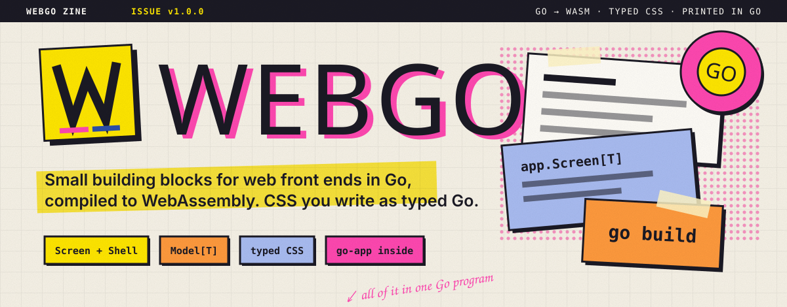
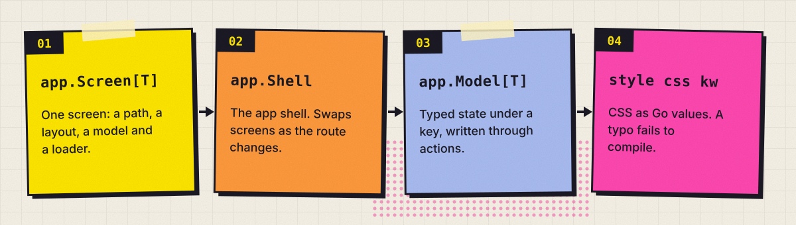
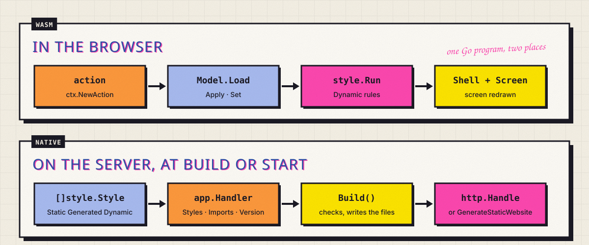
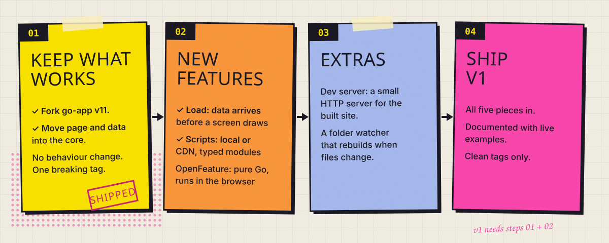

<p align="center">
<picture>
  <source media="(prefers-color-scheme: dark)" srcset=".github/readme/hero-dark.svg">
  
</picture>
</p>

<p align="center">
  <a href="https://toms223.github.io/WebGo/">
    <picture>
      <source media="(prefers-color-scheme: dark)" srcset=".github/readme/docs-dark.svg">
      
    </picture>
  </a>
</p>

WebGo is built from [go-app](https://github.com/maxence-charriere/go-app), whose code it now includes as the `app` package (MIT, see [NOTICE](NOTICE)), and adds three things: `Screen`, `Shell` and `Model` in `app`, which pair a layout with typed state, swap screens by route and load data before a screen draws; typed styling, which writes CSS as Go values that the compiler checks; and a markdown renderer for pages whose content is written as text.

<p align="center">
<picture>
  <source media="(prefers-color-scheme: dark)" srcset=".github/readme/features-dark.svg">
  
</picture>
</p>

**Documentation: https://toms223.github.io/WebGo/**

The docs site is itself a WebGo app — it is built with the packages it documents, and its markdown is rendered by `RenderMarkdown`. The source is in [`docs/`](docs/).

## Install

```sh
go get github.com/Toms223/WebGo@v1.0.0
```

`v1.0.0` is the current release. It moves the `page` and `data` packages into `app` as `Screen`, `Shell` and `Model` and deletes them, adds `OnLoad`, which lets any component load its data before it draws, adds the `script` package for typed ES modules, the `openfeature` package for feature flags, and the `dev` package for running a site locally. There is no `v0.2.0`: the work planned for it ships in `v1.0.0`. `v0.1.0` brought go-app into WebGo as the `app` package, added typed `Style(rules...)` on elements, folded `serve.Handler` into `app.Handler`, and fixed app updates. `v0.0.3` added `ViewModel.State()`; `v0.0.4` made `Base` work when the app is mounted under a subpath rather than at the domain root; `v0.0.5` renamed the `model` package to `data`. `v0.0.1` and `v0.0.2` do not work and should not be used.

Everything comes from this one module: `app` is `github.com/Toms223/WebGo/app`.

## Quick start

A WebGo app is one Go program that runs in two places: compiled to WebAssembly in the browser, and natively on your machine to serve or generate the site.

```go
package main

import (
	"net/http"

	"github.com/Toms223/WebGo/app"
)

type hello struct {
	app.Compo
}

func (h *hello) Render() app.UI {
	return app.Text("Hello, WebGo")
}

func main() {
	app.Route("/", func() app.Composer { return &hello{} })
	app.RunWhenOnBrowser()

	http.Handle("/", &app.Handler{Name: "Hello"})
	http.ListenAndServe(":8080", nil)
}
```

`app.RunWhenOnBrowser` takes over when the binary is running as WebAssembly and does nothing otherwise, so execution falls through to the server code on your machine. Register every route before calling it, and return a fresh component instance from each factory.

Build the browser binary, then run the server:

```sh
GOARCH=wasm GOOS=js go build -o web/app.wasm .
go run .
```

## The parts

| Type | What it does |
| --- | --- |
| `app.Screen[T]` | One screen: a path, a `Layout[T]`, a `Model[T]`, and an optional loader that runs before it draws |
| `app.Shell[U]` | The app shell: holds the screens and switches between them on navigation; `app.Serve` registers their routes |
| `app.Model[T]` | Typed state under a key; every `Set` notifies observers and fires an action named after the key |
| `app.Layout[T]` | Interface you implement: loading, error and drawn states |
| `app.Routed` | Interface a screen satisfies; `*Screen[T]` already does |
| `style.Rule` | One CSS rule as a Go value: a selector, its properties, its pseudo-class, `@media`, `@container` and `@supports` blocks, and nested rules |
| `style.Item` | Anything a stylesheet holds: a `Rule`, `KeyframesRule`, `FontFaceRule`, `PropertyRule`, `ImportRule`, `LayerRule` or `LayerOrderRule` |
| `style.KeyframesRule` and friends | `@keyframes`, `@font-face`, `@property`, `@import` and `@layer` as Go values, made by `Keyframes`, `FontFace`, `Property`, `Import`, `Layer` and `LayerOrder` |
| `style.Binding` | A typed link from an action to a rule: `When` decides presence, `Compute` and `ComputeFrames` decide the properties or frames |
| `style.Style` | How items reach the browser: a `Static` file, a `Generated` file, or `Dynamic` items switched by actions |
| `app.Handler` | The one handler: `Styles []style.Style`, `WebDir`, `DisableAutoUpdate`; `Build()` checks the styles and writes the generated files, and runs by itself on the first request |
| `css` | Typed values (`Px`, `Hex`, `Var`, `Calc`, `Raw`), one function per CSS property, and `Important()` on every property |
| `css.Descriptor` | One declaration inside `@font-face` or `@property`, such as `css.Src` or `css.Syntax` |
| `kw` | One typed constant per CSS keyword and named color, such as `kw.Underline` |
| `media` | Media queries (`Screen`, `Print`, `Not`, and `And` and `Or` on a query) and the functions for each media feature |
| `container.Query` | Container queries (`Named`, `Not`, `And`, `Or`) and the functions for each container feature |
| `supports.Query` | `@supports` conditions: `Property`, `Selector`, `FontFormat`, `FontTech`, `Not`, `And`, `Or` |
| `markdown` | Renders a markdown string into `[]app.UI` |

### Building a screen

`Screen` is built by chaining. The first error is latched, so later calls become no-ops and `Err()` reports what went wrong.

```go
model, err := app.NewModel("app", &AppState{})
if err != nil {
	log.Fatal(err)
}

settings := app.NewScreen[AppState]("/settings").
	WithLayout(&settingsLayout{}).
	WithModel(model)

if err := settings.Err(); err != nil {
	log.Fatal(err)
}
```

`NewScreen("")` serves `/`: `Route()` always returns a leading slash.

### Implementing a layout

```go
type Layout[T any] interface {
	Loading() app.UI
	Error(error) app.UI
	Draw(m *app.Model[T]) app.HTMLDiv
	Body(...app.UI) Layout[T]
}
```

`Loading` shows while the screen's loader runs, `Error` shows for a builder error or a failed load, and `Draw` renders the real thing. A screen without a loader also shows `Loading` for one frame, while its empty load comes back. The screen picks between the three for you, so a layout never needs its own conditionals.

> `Body` is called on **every** render of a `Shell`. Store what it hands you by replacing the previous content, not by appending to it, or the slice grows without bound.
>
> Screens are built once and reused, so `Draw` must keep the `Body` content at the same position under the same elements on every render. Vary what is around it, not where it is, or the engine panics with "component is already mounted".

### Loading before a screen draws

```go
settings := app.NewScreen[AppState]("/settings").
	WithLayout(&settingsLayout{}).
	WithModel(model).
	WithLoader(func(ctx app.Context, st *AppState) error {
		user, err := fetchUser()
		st.User = user
		return err
	})
```

The loader runs in the browser, on its own goroutine, after the screen mounts and again after it is updated. It fills a shallow copy of the state. While it runs, the layout's `Loading` shows. When it returns `nil`, the copy becomes the model's state through `Set`; when it returns an error, the layout's `Error` shows. It never runs on the server.

> The copy is shallow: slices and maps inside the state are shared with the model. Assign a new slice or map in the loader; appending to the existing one is a data race.

Any component can do the same by implementing `OnLoad(app.Context) error`, with optional `Loading() app.UI` and `Error(error) app.UI`. The wait is per component: siblings and ancestors keep rendering.

### Writing state

State flows one way: something writes through the model, the layout reads it back in `Draw`.

```go
func (l *layout) rename(ctx app.Context, e app.Event) {
	model.Load(ctx).Apply(func(ctx app.Context, st *AppState) *AppState {
		st.User = ctx.JSSrc().Get("value").String()
		return st
	}).Set()
}

func (l *layout) Draw(m *app.Model[AppState]) app.HTMLDiv {
	return app.Div().Text(m.State().User)
}
```

`Set()` writes to the state store, notifies observers and fires an action named after the model's key. `SetAndPersist(v)` also persists it. A verb that returns `nil` leaves the state untouched; one that returns a new pointer replaces it, and observers follow the model, not the pointer.

### Assembling the shell

```go
func main() {
	app.Serve(func() *app.Shell[AppState] {
		home := app.NewScreen[AppState]("/").WithLayout(&homeLayout{}).WithModel(model)
		settings := app.NewScreen[AppState]("/settings").WithLayout(&settingsLayout{}).WithModel(model)
		shell, err := app.NewShell(&appLayout{}, model, home, settings)
		if err != nil {
			panic(err)
		}
		return shell
	})
	app.RunWhenOnBrowser()

	http.Handle("/", &app.Handler{Name: "My app"})
	http.ListenAndServe(":8080", nil)
}
```

`Serve` registers every screen's route. `build` must return new screens, and may return a new layout, on every call: a screen built once outside it and reused fails on the server's second request with "component is already mounted". In the browser the shell is built once and kept across navigations. `Shell.OnNav` matches the current path against each screen's `Route()` and selects the first match. If nothing matches, it renders `Error(ErrNoRoute)`.

### Mounting under a subpath

Screens always use paths rooted at `/`. They never need to know where the app is served from.

The shell reads the mount from `GOAPP_ROOT_PREFIX`, which `app.Handler` sets from its `Resources`: `app.GitHubPages("WebGo")` makes it `/WebGo`, the default makes it `/`. The shell subtracts that prefix before matching and puts it back in the address bar after each navigation. So an app whose screens are `/`, `/markdown` and `/state` runs at `example.com/` and, generated with `app.GitHubPages("docs")`, at `example.com/docs/`.

You only need the mount yourself when building a URL to something that is not a route, a data file, say:

```go
source := strings.TrimSuffix(app.Getenv("GOAPP_ROOT_PREFIX"), "/") + "/data/page.md"
```

Trim the slash: without a prefix the variable is `/`.

### Rendering markdown

```go
ui := markdown.RenderMarkdown(source, markdown.Style{
	Heading:    "doc-heading",
	Subheading: "doc-subheading",
})
```

Returns one `app.UI` per top-level block, or `nil` for empty input. It is a deliberate subset: headings, lists, blockquotes, code blocks, thematic breaks, emphasis, code spans and links. Heading levels 1–2 become `h3` with your `Heading` class, deeper levels become `h4` with `Subheading`.

Links are filtered. Relative paths starting with `/`, anchors, `http://`, `https://` and `mailto:` become anchors carrying `rel="noopener noreferrer"`; everything else — including bare relative links like `guide.md` and protocol-relative `//host` — renders as a plain `span`. Tables and other GitHub extensions are not supported and pass through as text.

### Feature flags

The `openfeature` package is an OpenFeature SDK for the browser. Bind a provider once, then evaluate flags from any component; a failed evaluation returns the default you passed.

```go
p := memprovider.New(memprovider.Flag{
	Key:            "new-nav",
	Variants:       map[string]any{"on": true, "off": false},
	DefaultVariant: "on",
})
if err := openfeature.SetProviderAndWait(p); err != nil {
	log.Print(err)
}

on := openfeature.GetClient().Boolean("new-nav", false)
```

`memprovider` holds flags in memory, `jsprovider` wraps any JavaScript OpenFeature web provider, and `flipt` loads the official Flipt one. See [Feature flags](https://toms223.github.io/WebGo/feature-flags).

### Errors

`ErrNoLayout`, `ErrNoModel`, `ErrNoScreens` and `ErrNoRoute` are exported sentinels. Match them with `errors.Is`.

### Styling

<p align="center">
<picture>
  <source media="(prefers-color-scheme: dark)" srcset=".github/readme/typed-dark.svg">
  
</picture>
</p>

CSS is written as typed Go. A `style.Rule` is a selector with its properties; `css` supplies the values and one function per property, `kw` the keywords, and `media`, `container` and `supports` the queries. A property that does not exist or a misspelled keyword fails to compile.

The docs cover it on two pages: [Styling](https://toms223.github.io/WebGo/styling) for writing rules and [Applying](https://toms223.github.io/WebGo/applying) for delivering them. Both have live examples. Beyond plain rules:

- nesting with `Nest` and `Self()`, written as CSS nesting;
- `@keyframes`, `@font-face`, `@property`, `@import` and `@layer`;
- `!important` through `Important()` on a property;
- `@container` and `@supports` blocks through `Container` and `Supports`;
- typed bindings: `Bind(style.When(...))` and `Bind(style.Compute(...))` insert, remove or recompute a rule from an action's typed value;
- every `Set` on an `app.Model` fires an action named after its key, so bindings on that key follow the model's state.

```go
package theme

import (
	"github.com/Toms223/WebGo/css"
	"github.com/Toms223/WebGo/kw"
	"github.com/Toms223/WebGo/media"
	"github.com/Toms223/WebGo/style"
)

var Card = style.Class("card").
	Set(css.Padding(css.Rem(1)), css.BorderRadius(css.Px(8)))

var Link = style.Class("nav-link").
	Set(css.Color(css.Var("--ink"))).
	Hover(css.TextDecoration(kw.Underline)).
	Media(media.Screen().And(media.MaxWidth(css.Px(600))), css.FontSize(css.Rem(0.9)))

func Styles() []style.Style {
	return []style.Style{
		style.Generated("/web/theme.css", Card, Link),
	}
}
```

Pass a rule to an element with `Style`: `app.Div().Style(theme.Card)`. `RawStyle(k, v)` still sets one inline property by string.

`app.Handler.Styles` takes `style.Style` values, each in one of three modes. `Static` links a `.css` file you wrote or a URL, `Generated` writes a `.css` file from your rules, and `Dynamic` inserts and removes rules in the browser in response to actions. `Build` checks the styles and writes the generated files:

```go
handler := &app.Handler{
	Name:   "Hello",
	Styles: theme.Styles(),
}
if err := handler.Build(); err != nil {
	log.Fatal(err)
}
http.Handle("/", handler)
```

`Build` writes `web/theme.css` only when its bytes change, so building twice leaves the file alone. Calling it is optional: the first request and `app.GenerateStaticWebsite` build the handler if nobody did. A server that fails to build logs the error and answers every request with a 500.

<p align="center">
<picture>
  <source media="(prefers-color-scheme: dark)" srcset=".github/readme/flow-dark.svg">
  
</picture>
</p>

`Dynamic` items need the browser side started. Call `style.Run` once in `main`, before `app.RunWhenOnBrowser()`; on the server it does nothing:

```go
style.Run(theme.Styles()...)
app.RunWhenOnBrowser()
```

The property functions, keywords, media features and pseudo-class and pseudo-element methods are generated from W3C webref and MDN browser-compat-data. Only properties that the latest release of Chrome, Chrome Android, Edge, Firefox, Firefox Android, Safari and Safari on iOS can all render are included, and one that is left out belongs in a `.css` file loaded with `Static`. To regenerate them, run this from the root of this repository:

```sh
go run ./internal/cssgen
```

`Build` returns sentinel errors such as `app.ErrMissingStyle` and `style.ErrDuplicateRule`. Match them with `errors.Is`. Every error is listed on the [Applying](https://toms223.github.io/WebGo/applying) page.

## Shipping a static site

`GenerateStaticWebsite` writes `index.html`, the go-app runtime files, and one HTML file per registered route:

```go
app.Route("/", func() app.Composer { return &hello{} })
app.RunWhenOnBrowser()

if err := app.GenerateStaticWebsite("dist", &app.Handler{Name: "Hello"}); err != nil {
	log.Fatal(err)
}
```

Build `web/app.wasm` first — the generator does not produce it, and expects it to already be in place.

Because routing happens in the browser, the host must serve `index.html` for unknown extensionless paths. Most static hosts do this by default; GitHub Pages does it via `404.html`.

## Running locally

`dev.RunDevServer` builds the static site into a folder, serves it, and rebuilds when a `.go` file, `go.mod`, `go.sum` or a `web/` asset changes. A build that fails is logged and the last good one keeps being served.

```go
ctx, stop := signal.NotifyContext(context.Background(), os.Interrupt)
defer stop()
err := dev.RunDevServer(ctx, ".dev", "localhost:8000", func(dir string) *exec.Cmd {
	return exec.Command("go", "run", ".", "-static", dir)
})
```

The function you pass returns the command that writes your static site into `dir`, with `dir/web` as the handler's `WebDir`. `app.wasm` is built for you. The [Handler and deployment](https://toms223.github.io/WebGo/deploy#running-locally) page has a full `main`.

## Running the docs locally

```sh
cd docs
go run . dev
```

Then open http://localhost:8000. It rebuilds when you save. To run it the way it is deployed, behind the container's gateway:

```sh
cd docs
podman build -t webgo-docs .
podman run --rm --sysctl net.ipv4.ip_unprivileged_port_start=0 -p 8080:80 webgo-docs
```

Then open http://localhost:8080. The gateway listens on port 80 inside the container and runs as a non-root user, which is what the `--sysctl` flag is for.

## Deploying the docs

[`.github/workflows/pages.yml`](.github/workflows/pages.yml) builds the site and publishes it to GitHub Pages on every push to `main`.

A project Pages site is served from `/<repo>/`, not the domain root, so the build passes the repository name to the generator:

```sh
go run . static -o dist --github-pages WebGo
```

That sets go-app's resource resolver, so the generated HTML points at `/WebGo/app.js`, `/WebGo/web/app.wasm` and so on instead of the domain root.

The same resolver sets `GOAPP_ROOT_PREFIX` to `/WebGo`, and the shell strips it before matching routes. Without the flag it is `/`, so the same source serves from `/` in the container and from `/WebGo/` on Pages.

## Roadmap to v1

WebGo is becoming its own framework instead of a layer on go-app. Some of what it needs can't be done from outside go-app, so WebGo is taking go-app's code over. `v0.1.0` shipped the fork. Everything below is done and ships in `v1.0.0`. `v0.2.0` was going to carry the first half; it was never tagged, because the second half was finished before it went out.

<p align="center">
<picture>
  <source media="(prefers-color-scheme: dark)" srcset=".github/readme/roadmap-dark.svg">
  
</picture>
</p>

The order is: keep what already works, then the new features, then the extras. v1 needs everything in the first two steps.

### 1. Keep what works

- Copy go-app v11 into this repository with its MIT licence and its tests. After that, WebGo imports nothing from go-app.
- Move `page` and `data` into the core. Done: they are `app.Screen`, `app.Shell` and `app.Model`, and both packages are deleted. `style` stays a sibling package; its dependency direction is already right.
- Behaviour stays exactly as it is. The existing tests pass, and the docs site builds and runs the same at `/` and under `/WebGo`.
- Static generation keeps working the way go-app does it now: every registered route is rendered to HTML at build time.
- This is the one breaking tag. The import path changes, and the release notes say how to update.

### 2. New features

Each one gets its own design before any code is written.

**Load.** Done, browser only, as `OnLoad` on any component. It runs in the browser, on its own goroutine, after `OnMount` and again after `OnUpdate`, and the component is not drawn until it returns. Meanwhile its `Loading()` shows, if it has one; on an error, its `Error(err)`. The wait is per component, so siblings and ancestors keep rendering. A screen gets one with `WithLoader`:

```go
app.NewScreen[AppState]("/settings").
	WithLayout(&settingsLayout{}).
	WithModel(model).
	WithLoader(func(ctx app.Context, s *AppState) error {
		user, err := fetchUser()
		s.User = user
		return err
	})
```

`OnLoad` never runs on the server. Keeping the old screen up while the new one loads is not built yet.

**Scripts.** Done, as the `script` package. A module is a Go type that says where its ES module comes from, `script.CDN` or `script.Local`, and what Go gets back from it. List it on `Handler.Imports`, which writes one importmap, and call it from a component with `script.Use`, which returns the typed value and `false` when the module did not load.

**OpenFeature.** Done, as the `openfeature` package: an OpenFeature SDK written from scratch in Go that runs in the browser. The official Go one is server-only. It follows the OpenFeature specification v0.9.0 and is tested against the official Web SDK. You register your own providers with it, or use `memprovider`, `jsprovider` or `flipt`. Flags are evaluated in the browser at runtime, and at build time only their default values exist.

### 3. Extras

**Dev server.** Done, as `dev.RunDevServer`: a very small HTTP server for the built site, and a folder watcher that rebuilds when a file changes. Serving pages per request still works in v1; it can only be removed now that this exists.

### What v1 means

The fork, the core move, `Load`, scripts and OpenFeature all ship. Each one is documented on the docs site with live examples, and every tag builds and passes its tests.

## Requirements

- Go matching the version in your `go.mod`
- `github.com/Toms223/WebGo` v1.0.0 or later

## License

WebGo is licensed under the [MIT License](LICENSE), so you can use it in any project, open source or not. The go-app code it includes is MIT too; [NOTICE](NOTICE) credits it and the other third-party code.
